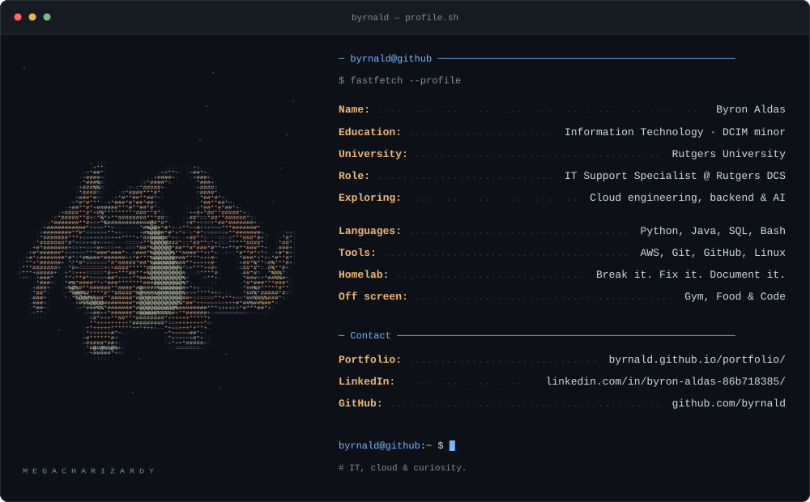

<picture>
  <source media="(prefers-reduced-motion: reduce) and (prefers-color-scheme: light)" srcset="assets/profile-light-static.svg">
  <source media="(prefers-reduced-motion: reduce)" srcset="assets/profile-dark-static.svg">
  <source media="(prefers-color-scheme: light)" srcset="assets/profile-light.svg">
  
</picture>

[Portfolio](<https://byrnald.github.io/portfolio/>) · [LinkedIn](<https://www.linkedin.com/in/byron-aldas-86b718385/>) · [GitHub](<https://github.com/byrnald>)

About me — text version

**Byron Aldas** — IT, cloud & curiosity. Always building something.

- **Education:** Information Technology · DCIM minor
- **University:** Rutgers University
- **Role:** IT Support Specialist @ Rutgers DCS
- **Exploring:** Cloud engineering, backend & AI
- **Languages:** Python, Java, SQL, Bash
- **Tools:** AWS, Git, GitHub, Linux
- **Homelab:** Break it. Fix it. Document it.
- **Off screen:** Gym, Food & Code

